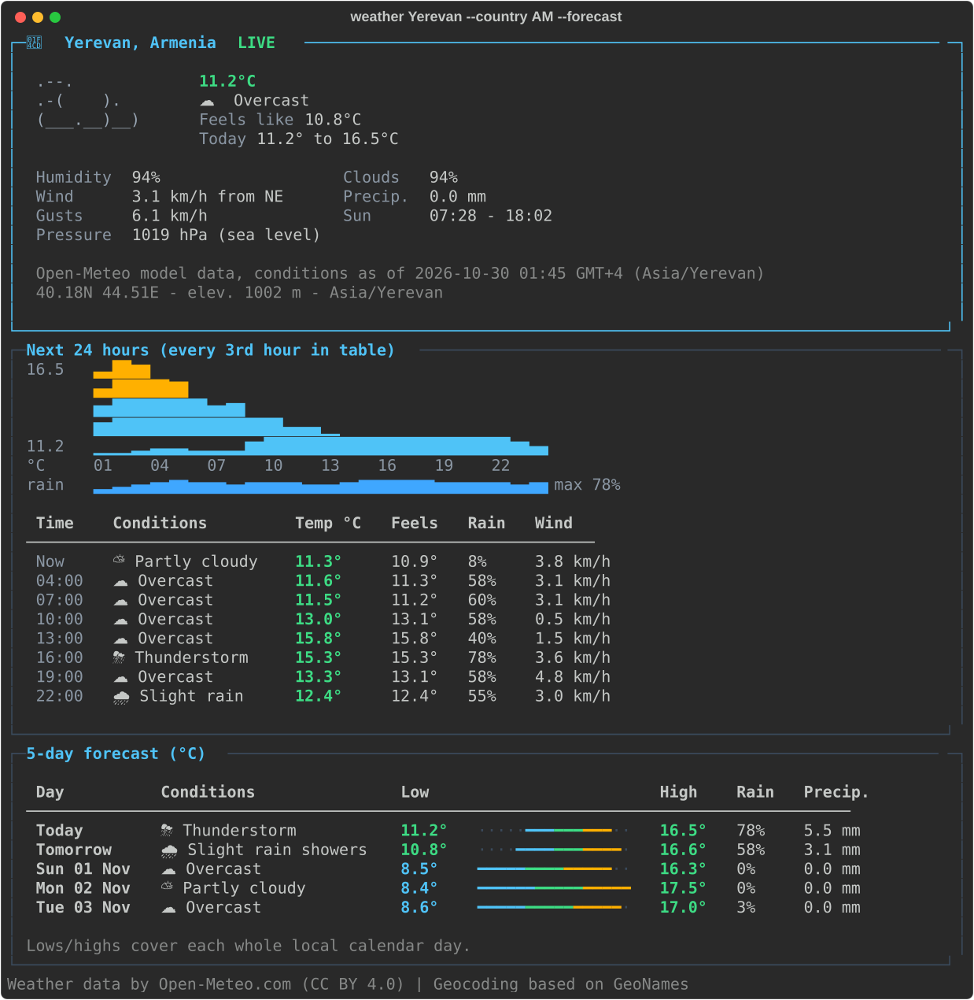

# Think Weather CLI

A Python command-line weather app. Type a city or postal code and get the current conditions, an hourly chart and a 5-day forecast in Celsius or Fahrenheit. It works as a polished dashboard, as plain text or as JSON. Live data comes from the keyless [Open-Meteo](https://open-meteo.com/) API.



<sub>The screenshots are real program output, recorded by Rich's SVG exporter with
`scripts/capture_screenshots.py`. The live ones show the weather on 2026-10-30.
More: [offline demo](docs/screenshots/demo-forecast.svg) ·
[US ZIP in °F](docs/screenshots/live-90210-imperial.svg).</sub>

---

## Quick start

You need **Python 3.11 or newer**, plus internet access the first time (to install dependencies). No API key is needed.

**Windows (PowerShell or CMD)**

```powershell
git clone <repository-url> think-weather-cli
cd think-weather-cli
.\run.bat Yerevan --forecast
# or: powershell -ExecutionPolicy Bypass -File .\run.ps1 Yerevan --forecast
```

**macOS / Linux**

```bash
git clone <repository-url> think-weather-cli
cd think-weather-cli
./run.sh Yerevan --forecast
```

On the first run the launcher creates a private `.venv` and installs the project into it. After that it only runs. The launcher never touches your global Python and never runs remote scripts. To reinstall after pulling new code, set `WEATHER_REINSTALL=1`.

**Standard Python setup (any OS)**

```bash
python -m venv .venv
# Windows: .venv\Scripts\activate      macOS/Linux: source .venv/bin/activate
python -m pip install -e .
weather Yerevan --forecast
```

You can also run it with uv: `uv run weather Yerevan` (a `uv.lock` is committed).

**Offline (no network at all):** `weather Yerevan --demo --forecast`. It uses a packaged sample that is clearly marked as **DEMO / SAMPLE DATA**.

---

## What it does

| Requirement | How it is met |
|---|---|
| Enter a city | `weather Yerevan`, `weather "New York"`, `weather "Springfield, Illinois" --country US`. Unicode names work, e.g. `weather Երևան`. |
| Enter a ZIP / postal code | `weather 90210 --country US`. Codes stay strings, so `00501` keeps its zeros. A country is required because postal codes repeat across countries. |
| Public weather API | Open-Meteo Forecast and Geocoding APIs (HTTPS, keyless). Optional Zippopotam.us fallback for postal codes, only in countries it lists. |
| Current temperature, description, humidity, wind | All shown, plus feels-like, gusts and compass direction, sea-level pressure, cloud cover, precipitation and sunrise/sunset. Values the provider does not supply show as `N/A`; nothing is invented. |
| Invalid input and API failures | Each failure gets a clear message, a `hint:` line and a distinct exit code (table below). There are no tracebacks unless you ask with `--verbose`. |
| Celsius / Fahrenheit | `--units metric\|imperial` (also `c`, `f`, `celsius`, `fahrenheit`). In interactive mode, `u` switches units without a new request. |
| **Bonus:** caching | A SQLite TTL cache shared between runs. Weather is kept 10 minutes and places 24 hours. If the service is down, a report up to 60 minutes stale is shown, clearly labelled **STALE**. |
| **Bonus:** graphics | Original ASCII weather art, condition icons always paired with text, an hourly temperature chart, a rain-chance sparkline, and min→max range bars per day. |
| **Bonus:** forecast | Both: a 5-day forecast (local calendar days) and the next 1–48 hours starting *now*. |
| **Bonus:** polished UI | A Rich dashboard that adapts from 40 to 140+ columns, a `--plain` ASCII mode, `NO_COLOR` support, `--output json`, and an interactive menu. |

### Examples

```text
weather                                   interactive mode (search, switch units, forecast, refresh)
weather Yerevan --country AM              current weather
weather "New York" --units imperial       °F and mph
weather 90210 --country US --forecast     US ZIP + 5-day + next 24 h
weather Yerevan --hours 12                next 12 hours: chart + table
weather Yerevan --plain --forecast        ASCII only: no colour, emoji or box drawing
weather Yerevan --output json             machine-readable, units spelled out
weather Yerevan --refresh                 ignore cached weather, fetch fresh data
weather Yerevan --no-cache                neither read nor write the cache
weather Yerevan --demo                    offline synthetic sample
weather cache stats | clear | path        inspect the local cache
```

### Exit codes and failure modes

| Situation | Example | Exit |
|---|---|---|
| Success | `weather Yerevan` | 0 |
| Unexpected bug (details with `--verbose`) | n/a | 1 |
| Invalid input, caught before any request | empty text, `--country ARM`, `--hours 99`, postal code without `--country` | 2 |
| Place or postal code not found | `weather DefinitelyNotARealCity999999 --country US` | 3 |
| Ambiguous place: lists the candidates, never guesses | `weather Springfield --country US` | 4 |
| Network down, timeout, provider 5xx or malformed data | (offline) | 5 |
| Rate limited (HTTP 429) | n/a | 6 |

Transient failures (timeouts, connection errors, 429/5xx) are retried at most twice, with capped exponential backoff and jitter. If the server asks the client to wait more than 8 seconds, it fails fast with "try again later" instead of freezing the terminal.

---

## How it works

```text
            ┌──────────────┐   LocationQuery   ┌─────────────────────────────────────────┐
 argv/TTY ─▶│    cli.py    │──────────────────▶│              WeatherService             │
            │ interactive  │◀──────────────────│  resolve(): geocode ─▶ disambiguate     │
            └──────┬───────┘    FetchResult    │  fetch():   cache ─▶ provider ─▶ cache  │
                   │                           └───────┬───────────────┬─────────────────┘
                   ▼                                   │               │
            ┌──────────────┐                 ┌─────────▼──────┐  ┌─────▼──────────────┐
            │ rendering.py │                 │ providers/     │  │ cache.py (SQLite)  │
            │ Rich │ plain │                 │ open_meteo.py  │  │ codec.py (JSON)    │
            │ JSON │ charts│                 │ postal.py      │  └────────────────────┘
            └──────────────┘                 │ http.py        │
                                             └────────────────┘
```

- **Providers** are the only code that knows Open-Meteo's field names. They validate untrusted JSON (types, ranges, array lengths, units) and return immutable, typed domain models in canonical metric units.
- **Service** resolves the place and runs the read-through cache. Collaborators are injected, so tests and the offline demo use exactly the same path.
- **Rendering** is the only layer that converts units. It never fetches anything, so switching between °C and °F re-renders the same data.
- **The CLI** parses arguments, wires things together and maps errors to exit codes. It never makes HTTP calls.

Details, trade-offs and rejected alternatives are in [docs/architecture.md](docs/architecture.md).

**In plain words**, four helpers do the work:

- The **map finder** turns "Yerevan" into a point on the globe.
- The **weather reporter** asks the weather service about that point.
- The **notebook** (the cache) writes the answer down, so asking again in the next few minutes needs no new request.
- The **painter** draws the answer in your terminal in the units you like.

### Correctness details worth knowing

- **Time zones and DST.** Forecast times are requested as Unix timestamps and shown in the place's IANA time zone (`zoneinfo`). This keeps clock labels right across daylight-saving changes; tests cover New York's spring-forward and fall-back.
- **"Next hours" starts now.** The hourly view starts from the current local hour, not from midnight. Daily rows are the provider's local calendar days, starting with "Today".
- **Ambiguous names.** Exact names beat partial ones, and towns beat parks or airports. A place is chosen automatically only if it has at least 20× the population of every rival (Paris, France vs. Paris, Texas), and the output says so. Otherwise one-shot mode lists the candidates (exit 4), and interactive mode lets you pick by number.
- **Postal codes.** The app tries Open-Meteo first. For countries Zippopotam.us lists, it tries that service next. Coverage is not universal: Armenian postal codes such as `0010` are *not* indexed by either service, so the app says so and suggests `weather Yerevan --country AM`. It never makes up coordinates.
- **Model data, honestly labelled.** Open-Meteo's "current" values come from weather models, not a ground station. The dashboard says "model data, conditions as of HH:MM". Pressure is labelled "sea level", because the app requests `pressure_msl`.

### Cache semantics

| Data | Fresh for | Key |
|---|---|---|
| Geocoding results | 24 h | query name + country + result count |
| Weather report (current + hourly + daily, one request) | 10 min | provider + request version + lat/lon to 4 decimals (~11 m) |
| Stale fallback | 60 min past expiry | only for network/timeout/5xx, never for bad input or 429 |

The cache file lives in the OS cache folder (`weather cache path`). Set `THINK_WEATHER_CACHE_DIR` to override it. A corrupted, locked, read-only or outdated cache file is treated as a cache miss and never stops the app. The cache stores normalized metric data, not display strings.

---

## Development and verification

```bash
python -m pip install -e ".[dev]"
ruff format --check . && ruff check .
mypy src                                  # strict mode
pytest -q --cov=weather_cli               # offline: real sockets are blocked in tests
python -m build                           # sdist + wheel (the demo fixture is packaged)
```

These results were measured locally on Windows 11 on 2026-10-30:

| Check | Result |
|---|---|
| `pytest` on Python 3.11.9 and on Python 3.14.4 | 337 passed (each) |
| Coverage (branch) | 95.8 % (the CI gate is 90 %) |
| `ruff format --check`, `ruff check`, `mypy --strict` | clean |
| `python -m build`, then the wheel installed into a clean Python 3.12 venv, run from outside the repo | demo, JSON, plain, live ZIP and uninstall all OK |
| `uv lock` → `uv sync --locked` → `uv run weather --demo` | OK |
| Live calls (Open-Meteo) | Yerevan, 90210 (US), 00501 (US), Springfield (ambiguous), Paris, Երևան, unknown city, `0010 --country AM` all behave as described above |

The workflow in `.github/workflows/ci.yml` runs the same checks on Ubuntu, Windows and macOS with Python 3.11 and 3.13, then smoke-tests the built wheel. It needs no secrets and no network beyond package installation. *CI status is not claimed here until the workflow has run on GitHub.*

---

## Data sources, licence and limitations

- **Weather data © [Open-Meteo.com](https://open-meteo.com/)**, licensed under [CC BY 4.0](https://creativecommons.org/licenses/by/4.0/). **Geocoding** is based on [GeoNames](https://www.geonames.org/) (CC BY 4.0), served by Open-Meteo. The app prints this attribution with every report.
- **Licence terms for the free API.** Open-Meteo's free hosted API is for **non-commercial use only**, with fair-use limits ([terms](https://open-meteo.com/en/terms)). This project is a demonstration/evaluation tool. Commercial use requires a paid [Open-Meteo plan](https://open-meteo.com/en/pricing) or a self-hosted instance. Only the provider adapter would need to change.
- The optional postal fallback uses [Zippopotam.us](https://zippopotam.us/) and is attempted only for countries it lists. It was verified live for US ZIP codes. Zippopotam.us indexes only districts for GB, CA and NL (checked 2026-10-30). Full postcodes fall back to the district with a visible note: the weather is for the district area, not the exact street.
- There are no API keys, tokens or secrets in this repository, and none are needed.

**Known limitations**

- Postal-code coverage depends on third-party indexes and is not global (see above).
- `--plain` uses ASCII for every decoration. Place names are printed exactly as the geocoder returns them, so they may contain non-ASCII letters (e.g. "Île-de-France").
- Emoji width varies between terminals. If icons look misaligned, use `--plain`. Without a UTF-8 terminal, the app falls back to ASCII symbols automatically.
- The launchers were tested on Windows (`run.bat`, `run.ps1`). `run.sh` follows the same logic, but it was **not run** on macOS or Linux for this submission; CI covers the `pip install` path on those systems.
