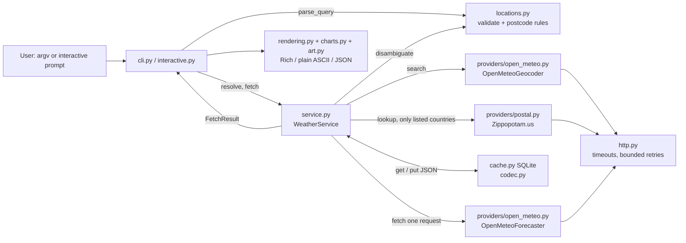

# Architecture and design decisions

## 1. Flow

Each request goes through these steps:

1. **Validate locally.** `parse_query` rejects empty, over-long or control-character input and bad country codes, and spots postal codes. This costs no network request.
2. **Resolve.** The service asks the geocoder (cached for 24 h), then `disambiguate` picks one place or returns candidates. For postal codes, Zippopotam.us is tried only if no geocoder result actually lists that postcode *and* the country is on Zippopotam's published list.
3. **Fetch.** One Open-Meteo request returns current + hourly + daily data for the chosen coordinates (cached for 10 min).
4. **Render.** The `FetchResult` is rendered in the requested units and format.

## 2. Component contracts

| Module | Responsibility | Must never |
|---|---|---|
| `models.py` | Frozen, slotted dataclasses: `Location`, `CurrentConditions`, `HourlyPoint`, `DayForecast`, `WeatherReport`, `FetchResult`. Canonical metric units; timezone-aware datetimes. | Hold display strings or converted units. |
| `providers/open_meteo.py` | Build requests and validate untrusted JSON (types, ranges, array lengths, units, timestamps) into models. | Leak Open-Meteo field names elsewhere. |
| `providers/postal.py` | Optional postcode → coordinates, only for listed countries. | Guess coordinates; query unlisted countries (e.g. AM). |
| `http.py` | HTTPS GET + JSON, timeouts (connect 3 s, read 5 s), ≤ 2 retries on timeouts, connection errors, 429 and 5xx, a cap on `Retry-After`, error mapping. | Retry 4xx; sleep for minutes; log query strings. |
| `locations.py` | Pure rules: validation, postcode detection, `City, Region` qualifiers, ranking, dominance, de-duplication. | Do I/O. |
| `service.py` | Use cases `resolve()` and `fetch()`; read-through cache; stale-if-error policy. | Know about argparse, Rich or JSON field names. |
| `cache.py` / `codec.py` | SQLite TTL store with schema version, and lossless JSON for models. | Raise to the caller: every failure is a miss. |
| `rendering.py`, `charts.py`, `art.py` | Unit conversion for display; Rich dashboard, ASCII text and JSON; charts with Unicode and ASCII alphabets. | Fetch data or touch the cache. |
| `cli.py`, `interactive.py` | Argument parsing, wiring, exit codes, stdout/stderr discipline, the prompt/menu loop. | Make HTTP calls; read stdin in one-shot mode. |

The service depends on three small `Protocol`s (`Geocoder`, `Forecaster`, `PostalLookup`). The offline demo plugs in fixture-backed versions of them. Tests plug in `httpx.MockTransport` behind the real adapters. As a result, the parser, service and renderers are the same code in live, demo and test runs.

## 3. Geocoding uncertainty and how it is handled

Open-Meteo's geocoder accepts both place names and postal codes, but coverage is not complete and it returns up to N ranked matches. The rules are:

- **Exact names win.** A case- and accent-insensitive exact name match beats partial matches ("Yerevan" beats "Yerevani").
- **Populated places win.** GeoNames feature codes starting `PPL` beat parks, dams and airfields.
- **No silent guess.** Several distinct places remain → *ambiguous*. One-shot mode exits with code 4 and lists the candidates; interactive mode asks the user to pick by number.
- **Dominance exception.** A place is chosen automatically only when its population is at least 20× that of every rival (Paris FR vs. Paris TX). The choice is printed as a note, together with how to pick another. Unknown populations never trigger this.
- **`City, Region`.** The geocoder ignores commas, so `"Springfield, Vermont"` searches "Springfield" with a larger result count (100 instead of 10) and filters on region/country locally. This came from an independent code review: smaller namesakes were outside the default top 10.
- **Postal codes.** Zippopotam.us indexes only districts for GB, CA and NL (checked 2026-10-30). Full codes fall back to the district with a visible note; weather is for the district area, not the exact street. The district follows the same Open-Meteo-first resolution as a direct district query. Strings, never integers, so `00501` keeps its zeros. A country is always required. **Armenian postal codes** are not indexed by Open-Meteo and are not listed by Zippopotam.us (checked 2026-10-30), so `0010 --country AM` reports "not found" with a hint to search by city. No hand-made Armenian postcode table was added, because no verified, redistributable source was available.

## 4. Time and units

- Forecasts are requested with `timeformat=unixtime&timezone=auto`. Each epoch is converted with `ZoneInfo(<response timezone>)`, so every hour gets its own correct UTC offset across DST changes. This is tested for New York's 2026 spring-forward (a 23-hour day, 02:00 skipped) and fall-back (a 25-hour day, 01:00 shown twice with different offsets).
- **Next N hours** starts with the hour that contains *now*. Aware datetimes are compared, which is also safe for half-hour time zones. Daily rows are the provider's local calendar days from "today" in the place's time zone, not the user's.
- Six days are requested so that five calendar rows and at least 24 upcoming hours exist at any time of day.
- Canonical units are °C, km/h, mm and hPa. Conversion happens once, in `rendering.Formatter`. Unit toggles in the interactive session re-render the same `FetchResult`, and a test asserts that no second HTTP request is made.
- Pressure is `pressure_msl` (sea level) and is labelled as such.

## 5. Cache trade-offs

- **SQLite (stdlib)** gives atomic writes, safe sharing between processes, and a single file the user can delete (`weather cache clear` removes it).
- **One combined report per coordinate** matches the one-request provider design. A separate current/forecast TTL would add complexity without saving requests.
- **Keys:** `open-meteo-forecast-v<request version>` + lat/lon to 4 decimals (~11 m, so city districts never collide); geocoding is keyed by normalized name + country + result count. A schema-version row resets the table when the format changes.
- **Failure policy:** a corrupt file is recreated; a locked, read-only or unwritable location disables the cache for that run; undecodable rows are misses. Diagnostics appear only with `--verbose`.
- **Stale-if-error:** only for transient outages (network, timeout, 5xx), at most 60 min past expiry, and labelled **STALE** with the real age. Never for bad input, 4xx or rate limiting.

## 6. Output discipline

- `--output json` writes exactly one JSON document to stdout, as ASCII-escaped UTF-8 with units spelled out. Errors in JSON mode are a JSON object on stderr (`{"error": {"code", "message", "hint", "exit_code"}}`).
- `--plain` uses no ANSI codes, emoji or box drawing. Non-TTY output disables colour automatically; `NO_COLOR` and `--no-color` are honoured; a non-UTF-8 console switches the dashboard to ASCII symbols.
- A closed pipe (`weather … | head`) exits quietly with code 0. Other OS errors are reported as internal errors, never as success.

## 7. Decision log

| Decision | Why | Rejected alternative |
|---|---|---|
| Open-Meteo as the only live provider | Keyless, so evaluators need no secrets; documented models, geocoding and time-zone handling. | A second provider (Weatherstack/OpenWeather) would need API keys, mix data semantics, and double the failure surface for no requirement. |
| No API keys anywhere | Nothing to leak; works right after cloning. | `.env` + key: an extra setup step and a leak risk. |
| `argparse` + Rich prompts, not a full-screen TUI | Works in every terminal and CI, is easy to test with scripted answers, and never traps the user. | Textual/curses: heavier, harder to test, fragile on Windows consoles. |
| Synthetic demo fixture in Open-Meteo's response shape | `--demo` exercises the real parser and renderers offline, and is clearly labelled as synthetic. | Recording live data and calling it a sample: risks passing stale data off as real. |
| setuptools backend kept | It was already working in the starter, and the wheel was verified to include the fixture. | Switching backends gives no benefit for this project. |
| Launchers only bootstrap a venv | Transparent, no global changes, no remote scripts. | Self-installing dependencies from inside `main.py`: unsafe and surprising. |
| No plotting dependency | Unicode/ASCII charts in ~100 lines cover the need with no extra dependency. | `plotext`/`matplotlib`: heavy, and either terminal-hostile or needs a GUI. |

**Overengineering avoided on purpose:** async I/O, plugin systems, multi-provider fan-out, HTML export, animations, telemetry and Docker. None of them improves a command-line weather lookup.

## 8. Quality evidence

- 340 offline tests. A socket guard makes any accidental real network access fail the test.
- Branch coverage is about 95 %, with a gate at 90 %.
- `ruff` (including security `S` rules), `mypy --strict`.
- Warnings are errors in tests. This is how unclosed SQLite handles in the tests were caught on Python 3.14.
- An independent review pass found seven issues. Six were fixed with regression tests (`tests/test_regressions.py`). The seventh concerned Zippopotam postcode formats for GB and CA. Live checks on 2026-10-30 showed that GB, CA and NL index only districts, so full codes now fall back to the district with a visible note (tests in `tests/test_postal.py` and `tests/test_service.py`).
